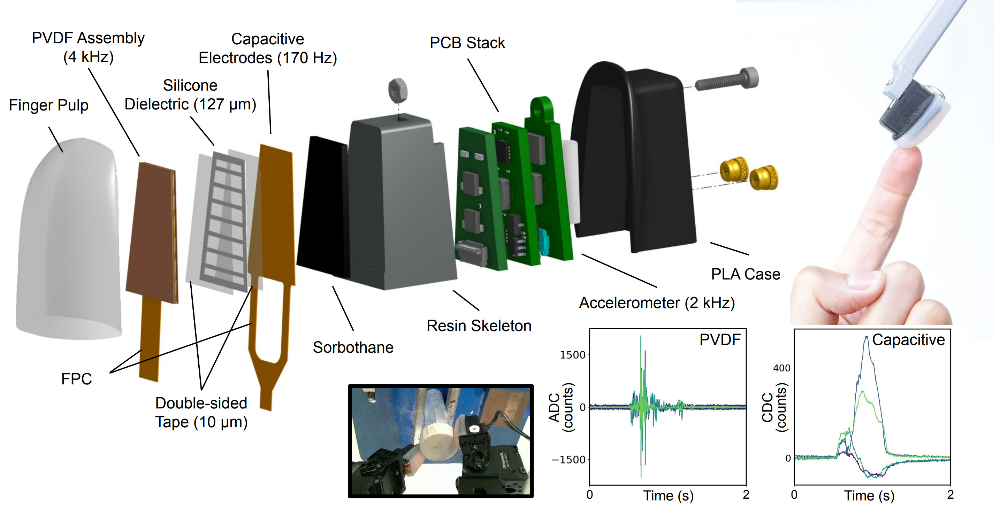
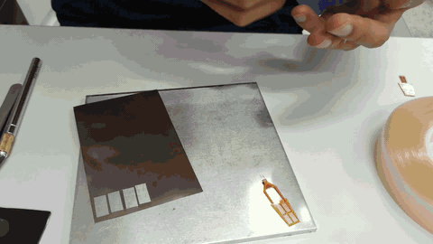
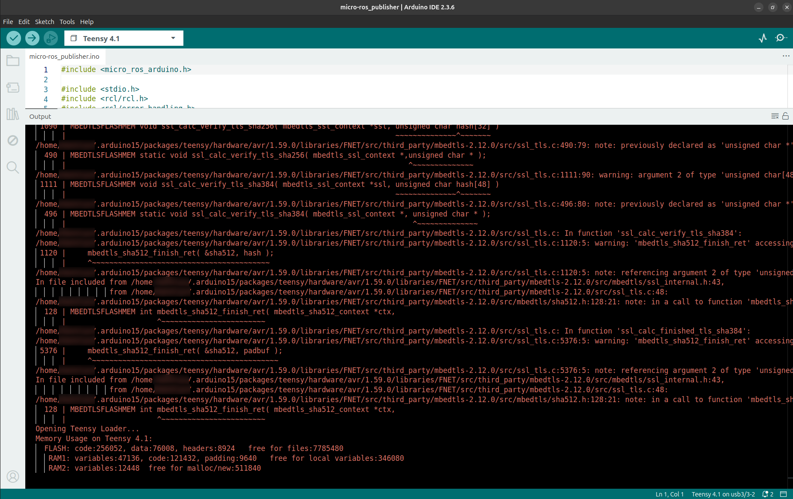
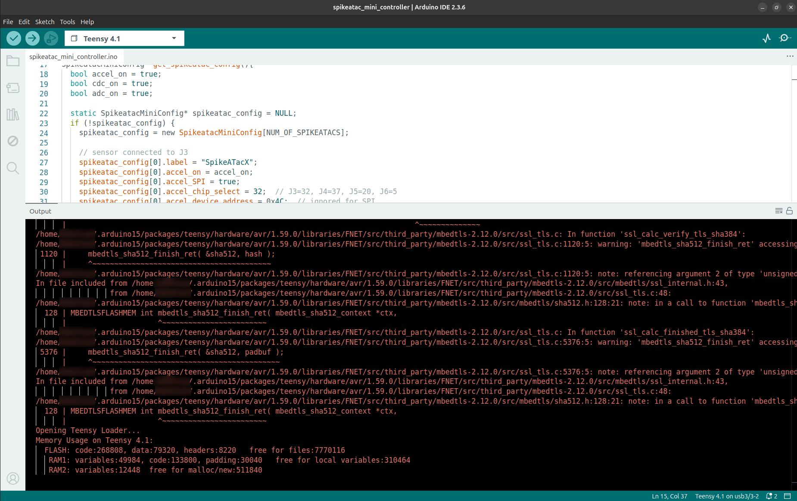
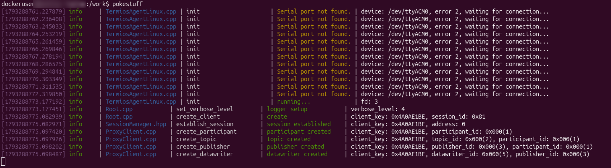

<h1 align="center">SpikeATac-Mini</h1>


<p align="center">
  <a href="PCB_ordering_instructions.md"></a>
  &nbsp;
  <a href="fabrication_instructions.md"></a>
  &nbsp;
  <a href="CAD/"></a>
  &nbsp;
  <a href="#using-spikeatac-mini"></a>
</p>


<br>
<br>

<p align="center">
  
</p>

Welcome to the SpikeATac-Mini hardware guide and documentation! SpikeATac-Mini is a human-scale, multimodal tactile fingertip. It contains a thin sensor stack combining **4 PVDF taxels** for dynamic sensing (sampled at 4 kHz) with **4 capacitive taxels** (170 Hz). A three-axis accelerometer (2 kHz) sits on the PCB stack.


SpikeATac-Mini is a version of our previous work [SpikeATac](roamlab.github.io/spikeatac) that is much easier to build. It uses only off-the-shelf materials (aside from custom PCBs) and can be assembled with standard equipment. It takes me around 50 minutes of active time to build a batch of sensors.

<p align="center">
  <a href="https://www.youtube.com/watch?v=I1HbFibuzbs">
    
  </a>
  <br>
</p>


<br>
<br>

<a id="using-spikeatac-mini"></a>
<h1 align="center">Using SpikeATac-Mini</h1>

# Requirements

**Hardware**
- A spikeatac-mini control board + Teensy 4.1
- One or more spikeatac-mini fingers, each with a JST cable
- 2x 9V batteries with barrel connectors attached
- A micro-USB to USB-A/USB-C cable (Teensy to PC)
- A PC to run the software below

**Software**
- A Linux PC — only tested on Ubuntu 22.04 and 26.04 (the Docker scripts assume a native X11 display and `/dev/ttyACM*` serial devices), but everything is containerized outside of firmware flashing
- Docker and Docker Compose
- Arduino IDE 2.3.4 and Teensyduino 1.59.0 (host-side only, used for flashing firmware — see [Firmware Flashing Setup](#firmware-flashing-setup-arduino-ide-teensyduino-micro-ros) below)

**Clone this repo (if you haven't already)**
```bash
git clone git@github.com:roamlab/spikeatac-mini.git
cd spikeatac-mini
```

# Setup

## Hardware setup

1. Connect the finger's JST connector to **J3** (use other ports (J4-J6) for additional fingers in the future — see [Flashing Firmware](#flashing-firmware) for the corresponding firmware config).
2. Connect 2 9V batteries to the two power terminals on the control board -- The red light on the control board should light up.
4. Connect a USB cable from the Teensy to the PC. The USB cable both powers the Teensy and carries the serial connection the micro-ROS agent talks over -- The orange light on the Teensy may light up, depending on what firmware is already flashed.

**Watch out for:**
- **Don't hot-swap the finger.** Disconnect the batteries before plugging in or unplugging the JST cable.
- USB power and battery power are independent: unplugging/plugging the USB cable power-cycles *only* the Teensy, while unplugging/plugging the batteries power-cycles *only* the fingers' ICs (accelerometer/ADCs, regulators, etc).

   
## Docker setup

All the ROS2/micro-ROS software (the agent that talks to the Teensy, PlotJuggler, the visualizer) runs inside a Docker container — see [`docker/README.md`](docker/README.md) for details. Short version:

```bash
cd docker
./build.sh   # first-time setup: build the image
./run.sh     # start the container and open a shell in it
```

From another terminal you can attach a second shell to the same running container with `./exec.sh`. The repo root is mounted into the container at `/work`.

Flashing the Teensy itself is **not** done inside this container. This will be done from the host via the Arudino IDE.

## Firmware Flashing Setup (Arduino IDE, Teensyduino, micro-ROS)

This is a one-time, host-side setup for compiling and flashing the firmware. The micro-ROS *agent* (the PC-side half that talks to the already-flashed Teensy) is handled entirely by the Docker setup above — nothing below is needed for that. If you're not flashing firmware you don't need to do this section (i.e., you're only talking with a pre-flashed Teensy). Note: a [micro-ROS Teensy + Arduino tutorial can also be found here](https://micro.vulcanexus.org/docs/tutorials/core/teensy_with_arduino/).

1. Install [**Arduino IDE 2.3.4**](https://www.arduino.cc/en/software).
2. Install [**Teensyduino 1.59.0**](https://www.pjrc.com/teensy/td_download.html) via the Arduino IDE's Boards Manager (Arduino 2.x/arduino-cli uses the Boards Manager flow, not the old Teensyduino Installer used with Arduino 1.x). Be sure to add the `00-teensy.rules` udev rules file (from PJRC's [Teensyduino download page](https://www.pjrc.com/teensy/td_download.html), under "stand alone files", or here: [00-teensy.rules](https://www.pjrc.com/teensy/00-teensy.rules).
3. Patch `platform.txt` by running the following. This patch is described in the [micro_ros_arduino github](https://github.com/micro-ROS/micro_ros_arduino/tree/humble). The arduino path is typically ~/.arduino15/packages/teensy. Teensyduino does NOT get installed in Arduino/libraries.

   ```bash
   export TEENSYDUINO_VERSION=[Your Teensyduino library version]  # e.g.: 1.59.0
   export ARDUINO_PATH=[Your Arduino + Teensyduino path] # e.g.: ~/.arduino15/packages/teensy
   cd $ARDUINO_PATH/hardware/avr/$TEENSYDUINO_VERSION/
   curl https://raw.githubusercontent.com/micro-ROS/micro_ros_arduino/humble/extras/patching_boards/platform_teensy.txt > platform.txt
   ```
  
4. Test the toolchain with the `micro-ros_publisher` example (confirms the micro-ROS Arduino install + patched `platform.txt` work):
   - In the Arduino IDE, open **File > Preferences** (ctrl+comma) and set **Sketchbook location** to this repo's `firmware` folder, e.g. `spikeatac-mini/firmware`. Click **OK**.
   - In the Arduino IDE, open **File > Examples > micro_ros_arduino > micro-ros_publisher**.
   - Select **Tools > Board > Teensy > Teensy 4.1** and the correct **Tools > Port**, then **Upload** (or ctrl+u).
       - Make sure the USB cable is not a charging-only cable (i.e. no data transfer). If the Teensy is not showing up in Ports, the cable is often the issue.
       - Some red text in the arduino terminal is expected. If 'done uploading' appears in the lower right, compiling and uploading was successful.

         <p align="center">
           
         </p>
   - Unplug the Teensy. Then, in the Docker container (`./run.sh` or `./exec.sh`), run the micro-ROS agent: `pokestuff` (wraps `ros2 run micro_ros_agent micro_ros_agent serial --dev /dev/ttyACM0`; use `pokestuff1` for `/dev/ttyACM1`).
     - Note: running the agent while the Teensy is already plugged in can cause a failed connection (see the order-of-operations note under [Running SpikeATac-Mini](#running-spikeatac-mini).
   - The agent should report a session being established, and `ros2 topic list` should show `/micro_ros_arduino_node_publisher`; `ros2 topic echo /micro_ros_arduino_node_publisher` should print an incrementing `Int32` once per second.

# Flashing Firmware

Kill the micro-ROS agent(s) if any are running.

1. Open the `firmware/spikeatac_mini_controller/spikeatac_mini_controller.ino` sketch in the Arduino IDE. If you haven't already, point the IDE's sketchbook location (Preferences > Sketchbook location) to this repo's `firmware/`.
2. Select **Tools > Board > Teensy 4.1**.
3. Select **Tools > Port** for the port the Teensy enumerates on (this varies by OS/USB port — plug in the Teensy first and check which port appears).
4. **Before uploading**, edit the sketch to match your hardware:
   - `NUM_OF_SPIKEATACS` must equal the number of fingers connected, which must equal the number of uncommented `spikeatac_config[i]` blocks below it.
   - By default, one finger is configured on connector **J3** (the active `spikeatac_config[0]` block). To add a second/third/fourth finger, connect them to **J4/J5/J6**, uncomment the `spikeatac_config[1/2/3]` block and set `NUM_OF_SPIKEATACS = 2/3/4`.
5. Click **Upload** (ctrl+u). Some warnings are expected in the Arduino-IDE terminal during compiling.

   <p align="center">
     
   </p>

# Running SpikeATac-Mini

1. Once the Teensy is flashed, unplug the USB. Then, run the micro-ROS agent inside the Docker container (see [Docker setup](#docker-setup)):

```bash
./run.sh   # or ./exec.sh if the container is already running
pokestuff  # runs the agent against /dev/ttyACM0.
# Use `pokestuff1` instead if the Teensy enumerates as `/dev/ttyACM1` — check with `ls /dev/ttyACM*` if unsure. Since nothing is connected, the agent will print `Serial port not found.`
```

2. Then, connect the Teensy.

**Note: run agent before connecting Teensy:** by default, the micro-ROS client running on the Teensy only looks for an agent at startup, so re-running the agent while the Teensy is already powered and running often fails to connect. To avoid this, run the agent *first*, wait for it to print `Serial port not found.`, and only then plug in the Teensy's USB cable. Once it connects you should see green text like `session established`, `participant created`, `publisher created`, etc.

<p align="center">
  
</p>

3. Once connected, verify data is flowing with:

```bash
./exec.sh  # exec into the container
ros2 topic list  # in the container
ros2 topic echo /satmini_pvdf_feedback
```

Add a zeroed/tared capacitive data topic with the following. Run it in another shell, and hold the finger still with no load for a moment afterward so its baseline captures correctly:
```bash
./exec.sh
sourceenv
./visualizer/zero_satmini_cap.sh
```

# Looking at signals in plotjuggler

In another shell in the container (`./exec.sh`):

```bash
ros2 run plotjuggler plotjuggler
```

Load the included layout via **Layout > Load layout**, pointing it at `plotjuggler_configs/satmini_multimodal_1.xml`, instead of adding topics manually. Click `yes`, then `OK` in the popups.

The plotjuggler window will have 3 tabs open. Tab1 shows PVDF, Tab2 shows zeroed capacitive data, and Tab3 shows accelerometer. Tab2's feed will only exist once you run the zeroing script.

# Running the visualizer

This repo also includes a visualizer overlays the live PVDF and capacitive signals on a photo of the finger. In another shell in the container (`./exec.sh`), run the visualizer — a standalone script (no PlotJuggler, no colcon build needed) that overlays the live PVDF and capacitive signals on a photo of the finger:

```bash
./exec.sh
sourceenv
./visualizer/boot_spikeatac_mini_viz.sh
```

It subscribes directly to the raw `/satmini_pvdf_feedback` and `/satmini_capacitive_feedback` topics and does its own internal baseline zeroing (median of the first 300 samples per topic) — so unlike the PlotJuggler section above, `zero_satmini_cap.sh` is **not** needed here; just the agent needs to be running.

PVDF taxels are drawn as filled circles (red → yellow → green by value); capacitive taxels are drawn as blue rings sized by magnitude, which vanish near baseline. Press `q` or close the window to quit.
