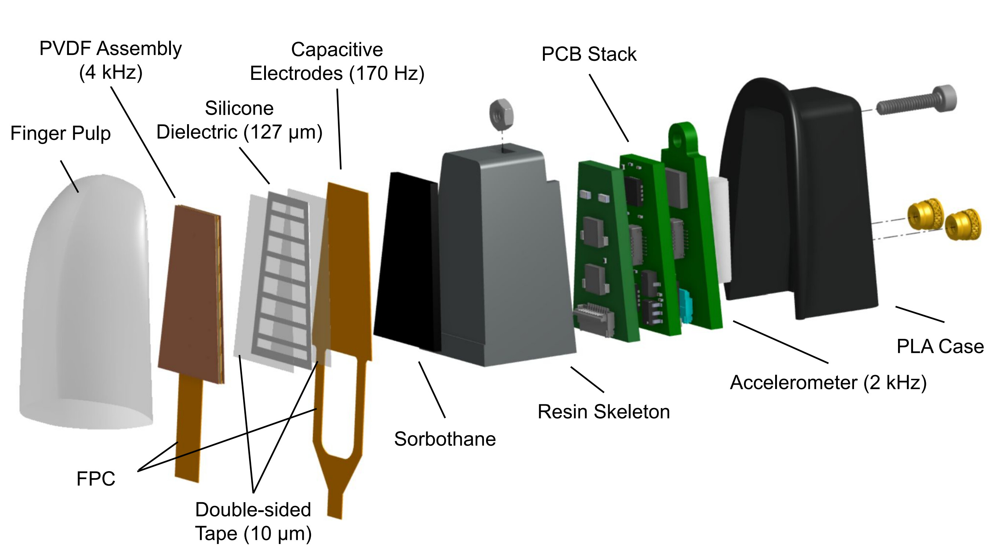
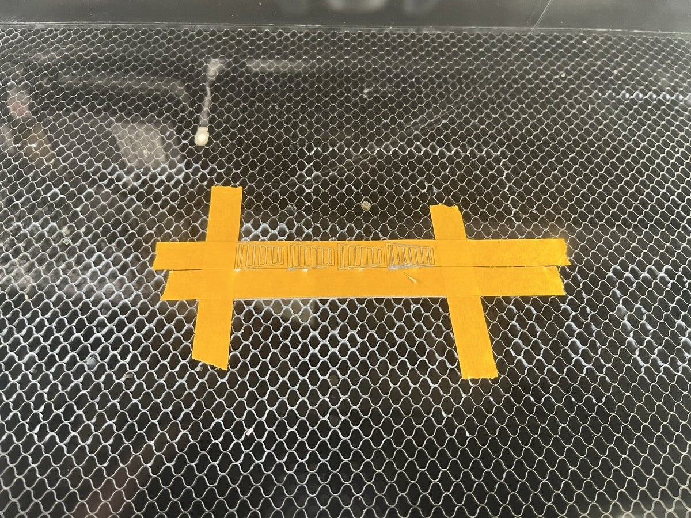

# Fabrication Instructions

Instructions for fabricating and assembling a SpikeATac-Mini finger.

> **Before you begin:** note that these fingers require PCBs and flex cables that typically take at least a week to get fabricated, see [PCB ordering instructions](PCB_ordering_instructions.md). Also be sure to read the chemical safety note below along with the SDSs it links.

## ⚠️ Chemical Safety Note

This fabrication process uses a few chemicals. They are safe and straightforward to use when handled properly, but they do require some attention to safety. **Please read the Safety Data Sheet (SDS) for each chemical before you begin.** Keep the following in mind:

- **Flammables.** Two of the products below are **flammable liquids**: **Inhibit X** and the **Momentive SS4120 primer**. Store them in an appropriate flammables cabinet, sealed and away from heat and ignition sources.
- **PPE.** Wear proper PPE including nitrile gloves when handling any of these chemicals.
- **Ventilation.** The Inhibit-X SDS recommends local exhaust ventilation. The SS4120 SDS considers general room ventilation satisfactory for the small quantities and room-temperature handling used here. I personally use a fume hood because I have access to one, but this is likely overkill.

If you are working in an institutional setting, follow the protocols and guidance of your Environmental Health & Safety (EHS) office.

**Safety Data Sheets (read before use):**

| Chemical | SDS |
|---|---|
| Inhibit X (Smooth-On) | https://www.smooth-on.com/msds/files/Inhibit-X.pdf |
| Ecoflex 00-30 (Smooth-On) | https://www.smooth-on.com/products/ecoflex-00-30/ *(SDS linked on page)* |
| Ease Release 200 (Smooth-On) | https://www.smooth-on.com/products/ease-release-200/ *(SDS linked on page)* |
| Momentive SS4120 primer | https://www.rshughes.com/p/Momentive-SS4120-Primer-Clear-0-8-Lb-Bottle-For-Use-With-RTV-Silicone-Rubber-Adhesive-SS4120-01P/ss4120_01p/ *(SDS linked on page)* |
| MG Chemicals 8330D silver conductive epoxy | Part A: https://www.mgchemicals.com/downloads/msds/01%20English%20Can-USA%20SDS/sds-8330d-part-a.pdf   Part B: https://www.mgchemicals.com/downloads/msds/01%20English%20Can-USA%20SDS/sds-8330d-part-b.pdf |

---

## Finger overview

  

---

## Bill of Materials

### Casting Materials

| Item | Notes | Link | Price |
|---|---|---|---|
| Ecoflex 00-30 elastomer | Silicone for finger pulp | https://theengineerguy.com/ecoflex-00-30/ | Trial kit ~$33 |
| Ease Release 200 | General-purpose mold release (aerosol) | https://www.smooth-on.com/products/ease-release-200/ | ~$12–20 |
| Inhibit X | Barrier layer | https://www.smooth-on.com/products/inhibit-x/ | ~$30 (pint) |
| Silicone primer SS4120 (Momentive) | Silicone adhesion primer | https://www.rshughes.com/p/Momentive-SS4120-Primer-Clear-0-8-Lb-Bottle-For-Use-With-RTV-Silicone-Rubber-Adhesive-SS4120-01P/ss4120_01p/ | ~$50–80 (pint) |
| M2 screws + square M2 nuts | Mold screws | McMaster-Carr / fastener supplier | ~$0.10–0.30 each |
| Mixing cups + popsicle sticks | Mixing Ecoflex | General supplier | ~$5–10 |

### Casting Tools

| Item | Notes | Link | Price |
|---|---|---|---|
| Paint brush (soft, fine) | For applying Inhibit X and primer, and spreading Ease Release | General supplier | ~$1–5 |
| Pipettes | For dispensing Inhibit X and primer | General supplier | ~$0.10 each |
| Scale (0.1 g resolution) | Weighing Ecoflex parts A and B | General supplier | ~$10–25 |
| Vacuum chamber + pump | Degassing Ecoflex | General supplier | ~$80–200 |

### Assembly Materials

| Item | Notes | Link | Price |
|---|---|---|---|
| Pre-metallized PVDF sheet | PVDF film, 110 um PVDF and 80 nm CuNi, SKU: PVDF-CuNi-P0110 | https://piezopvdf.com/metallized-pvdf-film-CuNi/ Select the correct option | $300 per 28x20cm sheet |
| 3M 9703 Z-axis PSA tape | Anisotropic conductive (Z-axis) tape | https://www.amazon.com/3M-9703-Electrically-0-75-36yds/dp/B00HDDQFZG | ~$25–40 per roll |
| Silicone sheet, 0.005" (127 µm), 30A durometer, pre-cured | Laser cut into the dielectric pattern | https://www.mcmaster.com/5542N644-5542N616/ | TODO |
| Nitto 6601 double-sided tape (10 µm) | Bonds the silicone dielectric between the PVDF and capacitive flex PCBs | https://www.alibaba.com/product-detail/Nitto-5601-Ultra-Thin-Transparent-PET_1601524443608.html | TODO |
| 3M copper foil shielding tape | Shield layer on both sides of the PVDF stack | https://www.amazon.com/3MTM-Copper-Foil-Shielding-12-70/dp/B007ZTA8CE | ~$8–15 |
| MG Chemicals 8330D silver conductive epoxy | Connects the copper tape to the flex PCB ground pads | https://mgchemicals.com/products/adhesives/electrically-conductive-adhesives/conductive-glue/ | ~$25–40 |
| Sorbothane sheet | Damping layer between the sensor stack and skeleton | https://www.mcmaster.com/8514K51-8514K111/ | $8.57 |
| CA glue | Secures the M1.6 nut in the skeleton | General supplier | ~$5 |
| Scotch or Kapton tape | Taping flex PCBs to the work surface | General supplier | ~$5–15 |
| Isopropyl alcohol (IPA) | Cleaning prints and the patterned silicone | General supplier | ~$5–10 |
| M1.6x8 screws | Fastening the case; holding the skeleton in the mold while casting | McMaster-Carr / fastener supplier | ~$0.10–0.30 each |
| M1.6 nuts | Glued into the skeleton | McMaster-Carr / fastener supplier | ~$0.05–0.20 each |
| M1.6 heat-set inserts | Threaded inserts for PLA case | https://www.mcmaster.com/94180A501/ | ~$0.20–0.50 each |

### Assembly Tools

| Item | Notes | Link | Price |
|---|---|---|---|
| X-Acto knife | **Use a fresh, sharp blade** for clean film/tape cuts | General supplier | ~$5–10 |
| Fine-point tweezers | Handling film and small parts | General supplier | ~$5–15 |
| Nitrile gloves | For handling chemicals | General lab supplier | ~$10–15 per box |
| Fine-tip marker | Labeling the + and − sides of the PVDF | General supplier | ~$2 |
| Multimeter | Checking quadrant isolation and the silver epoxy ground connection | General electronics supplier | ~$20–50 |

### Electronics & Other Materials

| Item | Notes | Link | Price |
|---|---|---|---|
| Teensy 4.1 | microcontroller to sample sensor and talk to PC | https://www.sparkfun.com/teensy-4-1.html | ~$32 |
| On-finger PCBs | PCBs are not permanent and can be swapped between fingers, therefore one need only order as many as are needed simultaneously. | See PCB ordering instructions | TODO |
| Control board | One control board can talk to up to 4 sensors. | See PCB ordering instructions | TODO |
| JST cable (A10SR10SR30K305A) | cable from control board to finger | https://www.digikey.com/en/products/detail/jst-sales-america-inc/A10SR10SR30K305A/6708492 | ~$1–5 each |
| USB cable | Micro-USB for Teensy to PC | General electronics supplier | ~$3–8 |
| 9V batteries ×2 | Power | General retailer | ~$3–6 each |

### Printing & Laser Cutting Materials

| Item | Notes | Link | Price |
|---|---|---|---|
| Grey Resin v5 | Finger skeleton + molds, printed on Formlabs Form 4 (SLA) | https://formlabs.com/store/materials/grey-resin/ | ~$150–200 / L |
| PLA filament | Finger case and stencils, printed on Bambu P1S (FDM) | Any PLA supplier | ~$18–30 / kg |
| Flush cutters + file | Removing supports from resin prints | General supplier | ~$10–20 |
| Laser cutter (CO2) | Cutting the silicone dielectric; we use a Glowforge Plus | — | — |

**Printing note:** The finger skeleton and molds are printed in Grey Resin v5 on a Formlabs Form 4; the finger case is printed in PLA on a Bambu P1S. If a resin printer is unavailable, order prints from a prototyping service (e.g., [jlc3dp.com](https://jlc3dp.com)) or print in PLA, keeping in mind:

- The elastomer-to-plastic bond will likely be **weaker** with PLA — the Inhibit X + primer protocol here was validated for the elastomer/resin interface but **not tested with PLA**.
- FDM-printed PLA molds will likely leave **layer-line imprints** on the elastomer. SLA molds were chosen for fine control of surface texture (smooth finishes or added surface features). Grey V5 resin was less prone to cure inhibition with the elastomer than Clear V5; with an Inhibit-X layer, Clear V5 molds were also acceptable.

---

## Fabrication video

The full fabrication process is shown in the video below. Each section of the instructions also links to its chapter in the video.

  
   
  <em>▶ Click to watch the assembly video on YouTube</em>

---

## A. Print parts, laser cut silicone

### 1. Print the molds and skeleton

Print the finger skeleton and molds in **Grey Resin V5**, using adaptive layer thickness or a **0.025 mm** layer thickness.

- **Skeleton:** angle it on the print bed so the outside is exposed to supports and there are limited supports on the internals of the skeleton.
- **Molds:** orient the print so there are no supports on the interior of the mold, which defines the finger's outer surface.

Post-process the prints:

1. Wash the parts for **10 minutes**.
2. UV cure at **60 °C for 15 minutes**.
3. Cut off the supports with flush cutters, file down any protrusions, and make sure all cavities are clear.
4. Clean the surface with IPA.

> ‼️ **Make sure the wash bucket is clean.** If the skeleton comes out sticky before curing, it will be essentially impossible to insert nuts and the elastomer may not cure properly.

### 2. Print the stencils and finger case

Print the stencils and finger case in PLA. Insert M1.6 heatset inserts into the case.

### 3. Laser cut silicone

Cut out the dielectric pattern from a pre-cured silicone elastomer using a laser cutter and the pattern file [`CAD/silicone_pattern.svg`](CAD/silicone_pattern.svg).

Settings we use for the 0.005" thick, 30A durometer strip:
- Glowforge Plus CO2 laser
- speed: 150
- power: 14%
- We cover the strip with a single layer of painter's tape to prevent the elastomer from blowing around as it cuts. See photo.

  

## B. Cut PVDF ([video](https://www.youtube.com/watch?v=eK7ZM5SWrWE&t=0s))

### 1. Align the PVDF sheets

Identify which side of the PVDF is **+** and which is **-**. It is best to hook the sheet up to an oscilloscope to test this, but for the sheets we used the matte side was positive. 

### 2. Cut and segment

1. Cut the PVDF into rectangles using the stencils. A sharp knife is necessary here. Label each rectangle with its **+** and **-** sides.
2. Place one of the rectangles into the stencil's holder with the **+** side up. Use a knife and the provided stencils to carefully slice the top layer of metal into 4 quadrants. Be carefuly not to slice all the way through the PVDF, only the top metal layer. Not much pressure is required.
3. Repeat for the other rectangle, with the **-** side facing up.
4. Test the resistance between quadrants to make sure that the metal is fully severed (all 4 quadrants should be electrically disconnected). Make further cuts if necessary.

## C. Assemble PVDF stack ([video](https://www.youtube.com/watch?v=eK7ZM5SWrWE&t=263s))

1. Tape down the flex PCB, text side up, with Scotch or Kapton tape.
2. Place Z-tape on top, press down firmly, and peel off the backing.
3. Place the PVDF, **positive side up**.
4. Cut a piece of copper tape that is slightly longer than the flexPCB. Leave/cut a small tab (roughly 3x3mm) in one corner of the tape. Fold this tab under so that the adhesive sticks against itself. This creates a small adhesive-free patch that will rest against the ground pad on the PCB. We'll later make this connection with silver epoxy.
5. Place copper tape over the flexPCB and press firmly.
6. Cut the assembly out from the surrounding tape.
7. Flip it over and repeat steps 2–6, but with the **− side** of the PVDF facing out.

## D. Apply silver epoxy ([video](https://www.youtube.com/watch?v=eK7ZM5SWrWE&t=783s))

1. Dispense equal parts (by volume) A and B. Mix thoroughly with a popsicle stick.
2. Apply a small amount of epoxy onto the ground pad on one side of the flexPCB. Press the small adhesive-free square on the copper tape down onto the epoxy.
3. Repeat step 2 for the other side of the PCB.
4. (not shown in the video) Place something heavy on top of the stack to press it down, and let cure for at least an hour.
5. (not shown in the video) After curing, test the connectivity between the copper tape and the FFC's ground pad (connector pad closest to the silver epoxy / ground pad side)

## E. Assemble capacitive stack ([video](https://www.youtube.com/watch?v=eK7ZM5SWrWE&t=990s))

1. Tape the capacitive flex PCB down to the work surface, **electrodes facing up**.
2. Clean the patterned silicone with IPA and/or apply and release scotch tape to remove debris.
3. Apply a piece of the Nitto tape, press firmly, and remove the backing.
4. Apply the silicone onto the stack and align the edges.
5. Apply a second piece of the Nitto tape, press firmly, and remove the backing.
6. Apply the PVDF assembly, **silkscreen text facing up**. The gold pads on the two FFC connectors should both be facing up.
7. Press down firmly.
8. Test the signals at this point, see usage instructions.

## F. Assemble skeleton ([video](https://www.youtube.com/watch?v=eK7ZM5SWrWE&t=1285s))

1. Insert an M1.6 nut into the skeleton.
2. Insert an M1.6 screw to align the nut.
3. Apply CA glue and let it dry while proceeding with the next steps.
4. Remove the screw once the nut is secure.
    - Note: Make sure the glue is completely dry before casting the elastomer in step H. If the glue dries against the screw after it is already in the mold, the mold can be difficult to disassemble.
5. Cut out a piece of sorbothane using the skeleton as a stencil. Apply it to the skeleton, aligning the bottom of the sorbothane to the notch in the skeleton face.
6. Apply the sensor assembly onto the sorbothane and press firmly.

## G. Apply Inhibit X and silicone primer ([video](https://www.youtube.com/watch?v=eK7ZM5SWrWE&t=1519s))

⚠️ I typically do these steps in a fume hood. See chemical safety note above.
1. Apply **2 coats of Inhibit X** to all surfaces of the skeleton+sensor assembly, as well as the internal surface of both sides of the mold. Let dry for **15 minutes** after each coat.
    - I use a pipette to remove a small amount of Inhibit X from the can and place it in one  of the mold cavities. Then I use a small paint brush to apply Inhibit X to the skeleton and other molds.
2. Apply **1 coat of SS4120 primer** **only to the skeleton**. Do NOT apply to the molds. Let dry for **15 minutes**.

## H. Cast elastomer ([video](https://www.youtube.com/watch?v=eK7ZM5SWrWE&t=1944s))

1. Spray the top and bottom molds with a light coating of Ease Release. Spread evenly with a paint brush.
2. Place the assembled skeleton into half of the mold (the half with the screw hole). Press firmly into place and insert an M1.6x8 screw until just tight.
3. Assemble the two halves of the molds together with square M2 nuts and M2 screws.
4. Mix equal parts **by weight** of parts A and B of Ecoflex 00-30. Mixing 15g (7.5g each part) is plenty for one finger.
5. Mix thoroughly. I usually mix for 1–3 minutes.
6. Degas in a vacuum chamber until the bubbles are gone. I do this at 0.75 bar for 5–10 minutes, or a few minutes longer if the bubbles haven't cleared by then.
   - Release the pressure quickly to help pop the bubbles. Quickly letting out some air and then re-pulling the vacuum also helps.
   - The elastomer can't sit here too long. Even though the working time is 45 minutes, pouring into the mold is difficult after ~20 minutes.
7. Carefully and patiently pour the elastomer into the mold. Fill to the top of the mold.
    - I aim to pour in only one portion of the opening to avoid introducing an air pocket. Pour with a slow, thin drizzle to prevent elastomer around the edge.
8. Let it cure for **at least 4 hours**. I usually cure for 8 hours or overnight.

## I. Demold Finger ([video](https://www.youtube.com/watch?v=eK7ZM5SWrWE&t=2459s))

1. Remove the mold screws.
2. Slowly and gently rotate the mold halves against each other without separating them to release the elastomer from the mold edges.
3. Once the elastomer begins to release, carefully separate the two halves.
4. Unscrew the M1.6 screw from the skeleton/mold. Leave the screw loose in the mold.
5. Remove the skeleton from the mold half. With a combination of the following two methods the skeleton releases easily:
    - Use a flathead screwdriver to pry the skeleton away from the mold. Don't use too much force as the skeleton can easily crack.
    - Press the loose screw sitting in the screw hole flat against a table to pop the skeleton away from the mold. Then, the skeleton should release easily.
6. Clean up the elastomer edges as needed.

## J. Assemble the Finger! ([video](https://www.youtube.com/watch?v=eK7ZM5SWrWE&t=2796s))

1. Assemble the rigid PCB stack with the sensor stack. Before connecting the 3 rigid boards together, insert the capacitive FFC and PVDF FFC into their respective ports. The wider PVDF connector will need to be fed through the capacitive FFC cable. **When looking down at the JST port, the silkscreen on the flexPCBs should face up.**
2. Place the rigid PCB stack into the skeleton.
3. Attach the case and secure everything with an M1.6x8 screw.